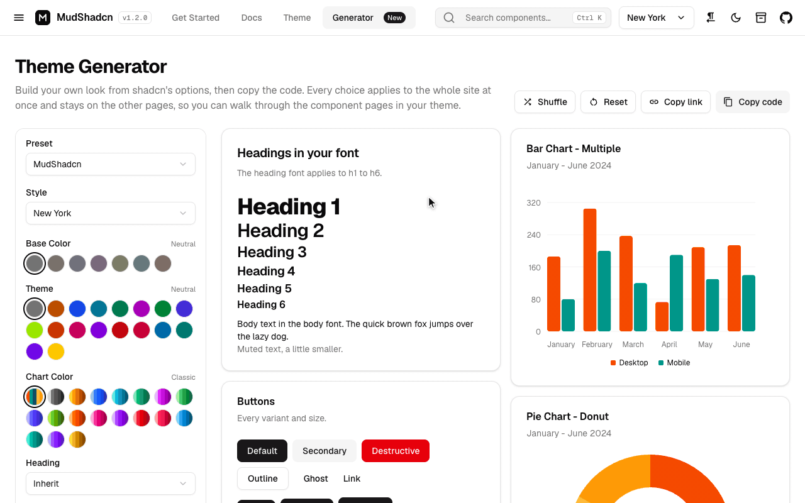
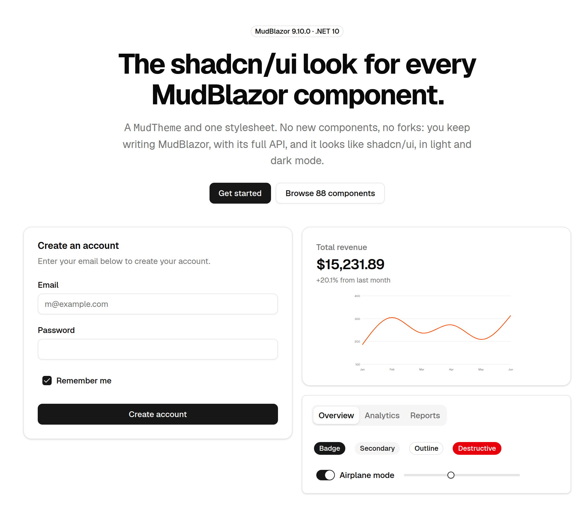
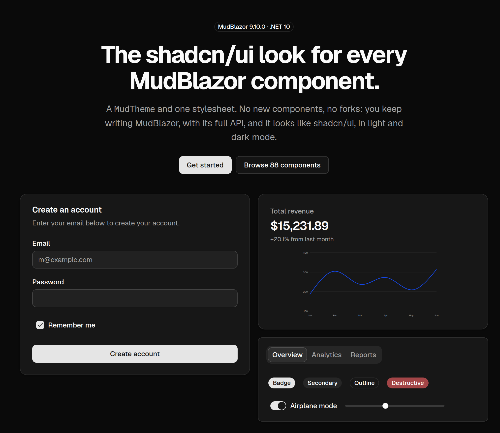

<p align="center">
  
</p>

<h1 align="center">MudShadcn</h1>

<p align="center">Make <a href="https://mudblazor.com">MudBlazor</a> look like <a href="https://ui.shadcn.com">shadcn/ui</a>.<br>One package, one stylesheet, no new components to learn.</p>

<p align="center">
  <a href="https://github.com/sardar97/MudShadcn/actions/workflows/ci.yml"></a>
  <a href="https://www.nuget.org/packages/MudShadcn"></a>
  <a href="https://www.nuget.org/packages/MudShadcn"></a>
  <a href="https://github.com/sardar97/MudShadcn/blob/master/LICENSE"></a>
</p>

<p align="center">
  <a href="https://mudshadcn.pages.dev"><b>Live showcase</b></a> ·
  <a href="https://mudshadcn.pages.dev/customization/theme-generator">Theme Generator</a> ·
  <a href="https://github.com/sardar97/MudShadcn/blob/master/docs/reference.md">Reference</a>
</p>

[](https://mudshadcn.pages.dev/customization/theme-generator)

## What you get

You keep writing ordinary MudBlazor, with its full API and documentation. MudShadcn only changes
how it looks: neutral colours, flat bordered surfaces, labels above inputs, shadcn's focus rings,
no ripple and no uppercase buttons.

- **Every component is restyled,** including the data grid, the pickers and the charts. The
  [showcase](https://mudshadcn.pages.dev) is MudBlazor's own documentation, running on MudShadcn.
- **Light and dark mode.** The app starts in the operating system's colour scheme.
- **shadcn's styles and colours.** The original New York look and the eight newer styles (Vega,
  Nova, Maia, Lyra, Mira, Luma, Sera, Rhea), every base colour and theme colour, plus radius, fonts,
  menus and five icon libraries. Pick a combination in the
  [Theme Generator](https://mudshadcn.pages.dev/customization/theme-generator) and copy the code.
- **One package to reference.** MudBlazor is installed with it, and you can still move to a newer
  MudBlazor whenever you like.
- **Easy to switch off.** `Enabled="false"` on the provider brings MudBlazor's own look back while
  the app runs.

| Light | Dark |
| --- | --- |
|  |  |

## Install

```
dotnet add package MudShadcn
```

This installs MudBlazor too, so you do not need a `MudBlazor` reference of your own. It needs
.NET 10 and MudBlazor 9.12.0 or newer. To use a newer MudBlazor, add your own `MudBlazor` reference
next to it and that version is used: see
[Versions](https://github.com/sardar97/MudShadcn/blob/master/docs/reference.md#versions).

## Set up

**1. `Program.cs`**: register the services. This calls MudBlazor's `AddMudServices` for you.

```csharp
using MudShadcn;

builder.Services.AddMudShadcn();
```

**2. `App.razor`**: link both stylesheets, MudBlazor's first, and MudBlazor's script.

```html
<link rel="stylesheet" href="@Assets["_content/MudBlazor/MudBlazor.min.css"]" />
<link rel="stylesheet" href="@Assets["_content/MudShadcn/MudShadcn.min.css"]" />
...
<script src="@Assets["_content/MudBlazor/MudBlazor.min.js"]"></script>
```

**3. `_Imports.razor`**

```razor
@using MudBlazor
@using MudShadcn
```

**4. Your layout**: add the provider. It replaces `MudThemeProvider`, `MudPopoverProvider`,
`MudDialogProvider` and `MudSnackbarProvider`, so remove those if you have them.

```razor
<MudShadcnProvider @bind-IsDarkMode="_isDarkMode" />

<MudLayout>
    ...
</MudLayout>

@code {
    private bool _isDarkMode;
}
```

That is all. Like MudBlazor's own providers, the provider has to be rendered interactively. The
[Use Cases](https://mudshadcn.pages.dev/getting-started/use-cases) page has the set-up for each
situation: an app that already uses MudBlazor, each hosting model, your own providers.

## Use it

Write MudBlazor as usual. If you know shadcn/ui, this is how its names map:

| shadcn/ui | MudBlazor |
|---|---|
| Button `default` | `Variant.Filled` `Color.Primary` |
| Button `secondary` | `Variant.Filled` `Color.Secondary` |
| Button `destructive` | `Variant.Filled` `Color.Error` |
| Button `outline` / `ghost` | `Variant.Outlined` / `Variant.Text` |
| Input, Select, Textarea | `Variant="Variant.Outlined"` |
| Badge | `MudChip` |
| Sonner (toast) | `ISnackbar` |
| Muted text | `Color.Tertiary` on `MudText` |

For inputs, use `Variant.Outlined`: that is shadcn's input, a bordered box with its label above it.
The [full table](https://github.com/sardar97/MudShadcn/blob/master/docs/reference.md#using-it)
also covers tabs, drawers, accordions and charts.

## Change the theme

Every option has a default, so name only the ones you want:

```csharp
var theme = MudShadcnTheme.Create(new ShadcnThemeOptions
{
    Style = ShadcnStyle.Nova,
    BaseColor = ShadcnBaseColor.Zinc,
    Theme = ShadcnColor.Blue,
    Radius = ShadcnRadius.Small,
    IconLibrary = ShadcnIconLibrary.Lucide,
});
```

```razor
<MudShadcnProvider Theme="theme" />
```

The quickest way to get this code is the
[Theme Generator](https://mudshadcn.pages.dev/customization/theme-generator): choose, or press
Shuffle, until you like what you see, then copy the code.

The result is an ordinary `MudTheme`, so your own colours work as they always do:

```csharp
theme.PaletteLight.Primary = "#2563eb";
```

## Documentation

| Where | What |
|---|---|
| [Installation](https://mudshadcn.pages.dev/getting-started/installation), [Use Cases](https://mudshadcn.pages.dev/getting-started/use-cases) | The set-up, step by step and for each kind of app. |
| [Theme Generator](https://mudshadcn.pages.dev/customization/theme-generator) | Every theme option on a live preview, with the code to copy. |
| [Theme](https://mudshadcn.pages.dev/customization/theme), [Icons](https://mudshadcn.pages.dev/customization/icons), [Charts](https://mudshadcn.pages.dev/customization/charts), [RTL Languages](https://mudshadcn.pages.dev/customization/rtl-languages) | Colours and tokens, the icon libraries, the chart presets, right-to-left layouts. |
| [Components](https://mudshadcn.pages.dev/docs/overview) | Every MudBlazor component and example, running on MudShadcn. |
| [Reference](https://github.com/sardar97/MudShadcn/blob/master/docs/reference.md) | The provider's parameters, switching looks while the app runs, the palette mapping, [where it differs from shadcn/ui](https://github.com/sardar97/MudShadcn/blob/master/docs/reference.md#where-it-differs-from-shadcn) and [versions](https://github.com/sardar97/MudShadcn/blob/master/docs/reference.md#versions). |
| [Changelog](https://github.com/sardar97/MudShadcn/blob/master/CHANGELOG.md) | What changed in each release. |

## AI coding assistants

MudShadcn publishes an [agent skill](https://mudshadcn.pages.dev/skill.md) and plain-text docs
([`llms.txt`](https://mudshadcn.pages.dev/llms.txt),
[`llms-full.txt`](https://mudshadcn.pages.dev/llms-full.txt)), so tools like Claude Code, Cursor or
Copilot set it up correctly. The NuGet package carries the skill too, as `docs/skill.md`. To use it
as a Claude Code skill:

```bash
mkdir -p ~/.claude/skills/mudshadcn
curl -fsSL https://mudshadcn.pages.dev/skill.md -o ~/.claude/skills/mudshadcn/SKILL.md
```

## Contributing

Issues and pull requests are welcome. If a component does not look like its shadcn/ui counterpart,
the most useful report names the MudBlazor component and variant and has a screenshot.

```bash
dotnet build MudShadcn.sln
dotnet run --project samples/MudShadcn.Showcase --launch-profile http   # http://localhost:5153
dotnet run --project samples/MudShadcn.TestApp --launch-profile http    # http://localhost:5152
tools/verify-mudblazor.sh                                               # after a stylesheet change
```

The package is in `src/MudShadcn` and its styling in `wwwroot/MudShadcn.css` there. Both sample apps
serve that file straight from `src/`, so a stylesheet change needs only a browser reload. Check it
in light and dark mode.

## Support the project

MudShadcn is free and open source, maintained in spare time. If it saves you work, you can
**[donate via PayPal](https://paypal.me/sardarqaslany)**. Starring the
[repository](https://github.com/sardar97/MudShadcn) and reporting issues help just as much.

## License

[MIT](https://github.com/sardar97/MudShadcn/blob/master/LICENSE) © Sardar Qaslany.

MudShadcn is not affiliated with shadcn/ui, Tailwind CSS or MudBlazor. It reproduces shadcn/ui's
design tokens and Tailwind's scales under their MIT licences; see
[THIRD-PARTY-NOTICES.md](https://github.com/sardar97/MudShadcn/blob/master/THIRD-PARTY-NOTICES.md).
